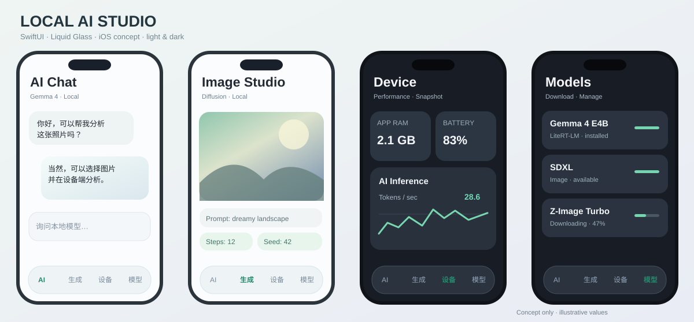

# Local AI Studio

A lightweight native iOS app for on-device AI, model files and device monitoring, built with SwiftUI and the system's Liquid Glass controls.

**Current implementation:** a usable model library, public device metrics, appearance settings, and an actual LiteRT-LM text inference path. **Gemma 4 E4B has not yet been run on a physical iPhone in this project.** Image generation and system extensions remain planned.



## What works in this version

- **Native navigation:** AI, Generate, Device and Models tabs; settings live in the Models tab. System/light/dark appearance, native accessibility behavior and an opaque composer when Reduce Transparency is enabled.
- **Model library:** single-file Files import, a visible import status with filename and cancellation, HTTPS file downloads, search, file size and metadata, and deletion. Duplicate names are stored independently.
- **File handling:** security-scoped access, coordinated and cancellable chunked imports, atomic model-directory commits, backup exclusion for weights, disk-space checks and preservation of original Files imports.
- **Downloads:** real progress, pause/cancel, saved requests and conditional resume data. Public Hugging Face resolve URLs work as direct links; repository pages, authentication and CivitAI parsing are not implemented. Entering the background pauses downloads. Resume depends on the server and system retaining the partial file.
- **Format recognition:** bounded inspection of LiteRT-LM, GGUF, TFLite and Safetensors headers. Architecture/quantization/adapter labels come from metadata or actual tensor keys. Files with .task, .ckpt and .bin extensions can be stored as explicitly unverified files; no pickle content is executed.
- **Text inference:** the official LiteRT-LM Swift package loads eligible .litertlm files, streams text, cancels native inference, unloads resources and restores conversation input/history after interruption. Model metadata is checked again by the engine before loading.
- **Performance:** real model load timing and engine-reported TTFT, output tokens and tokens/s, when available. No token counts are inferred from streamed chunks.
- **Device dashboard:** prominent app memory and CPU readings with native Charts for the last five minutes; process memory headroom and total physical RAM are labeled separately. Thermal state and battery/charging are visible together; Metal reports the hardware name, with device/storage/network details below. No invented GPU utilization, dedicated VRAM or Celsius temperature.
- **Continuous foreground monitoring:** one shared monitor samples every two seconds across all tabs. Inactive/background scenes stop sampling, preserving the latest snapshot and recent history. Resume resets the CPU time baseline and starts a separate chart segment; the last valid CPU reading keeps its own timestamp until a new reading arrives.

## Current limits

- **An imported file is not a verified runnable model.** Only LiteRT-LM text inference is connected. The first load on each session explicitly identifies the unverified memory requirement.
- There is one active inference at a time. Switching or deleting an active model waits for cancellation and resource release. Native model initialization itself cannot be interrupted; a stop request is applied once initialization returns.
- Dynamic context is capped at 2,048 tokens; fixed-context models use their own configuration. Responses are capped at 512 tokens. There is no silent conversation truncation.
- App backgrounding requests cancellation and unload, and retains input for a new generation. It does not claim background inference or continuation at the last generated token.
- No image/audio input, actual image generation, image saving/history, LoRA application, LoKr support, WidgetKit, App Intents or Live Activities yet.
- Community checkpoint containers and adapter keys can be identified without being compatible with an installed engine.
- iOS memory budgets change. The app does not use weight-file size as a peak-memory estimate or promise freedom from jetsam.
- Device testing is still required for large Files/iCloud imports, real HTTPS resume servers, memory pressure and E4B generation. Simulator hardware metrics describe the runner Mac.

See [the product plan](docs/PLAN.md), [inference research and exact compatibility limits](docs/INFERENCE.md), and [development guidelines](AGENTS.md).

## Build and test

Develop from Windows/WSL2 and use the Xcode 27 macOS GitHub Actions runner for builds. CI runs automatically: pull requests targeting `main` build the unsigned IPA and run all simulator unit/UI tests; pushes to `main` build and upload the unsigned IPA without re-running tests. No manual workflow dispatch is required. On pull requests it runs:

1. XcodeGen project generation.
2. Unsigned iPhone Release compilation.
3. Packaging of LocalAIStudio-unsigned.ipa with the layered app icon, plus export of the icon source and seven Apple-rendered previews.
4. Unit tests and UI tests on an available iOS 26 or 27 iPhone simulator (preferring iOS 26 when available), including tab/background monitoring, settings persistence and actual Files selection/import/error/cancel interaction.
5. Upload of the IPA, test results/logs and UI screenshots.

GitHub downloads the `LocalAIStudio-unsigned` artifact as a ZIP archive containing
`LocalAIStudio-unsigned.ipa`. Extract the outer ZIP once, then pass the **IPA**
to your local signing tool. The IPA itself is an archive and should remain
intact for signing. CI checks its ZIP integrity, executable, embedded LiteRT-LM
framework, app version metadata, icon registration and compiled asset catalog before uploading it.

The `LocalAIStudio-IconComposer` artifact contains the editable layered icon and
previews; the compiled icon is included in the IPA. See [icon source and rendering](docs/icon-composer.md).

The LiteRT-LM dependency is pinned to the official v0.18.1 commit rather than a floating branch; see [the dependency explanation](docs/INFERENCE.md). Model weights are not included.

On a Mac with Xcode 27 and XcodeGen:

```sh
export GIT_LFS_SKIP_SMUDGE=1
xcodegen generate
xcodebuild -project LocalAIStudio.xcodeproj -scheme LocalAIStudio \
  -configuration Release -destination 'generic/platform=iOS' \
  CODE_SIGNING_ALLOWED=NO build
xcodebuild -project LocalAIStudio.xcodeproj -scheme LocalAIStudio \
  -destination 'platform=iOS Simulator,name=<available iPhone>' \
  -only-testing:LocalAIStudioTests CODE_SIGNING_ALLOWED=NO test
```

The full UI suite needs the two tiny files prepared in the simulator's Documents directory by [the workflow](.github/workflows/ios.yml). It builds the test targets, boots and installs the Debug app, seeds the files, and runs `test-without-building`. Only Debug enables Documents sharing so the system Files picker can select these fixtures. Release behavior is unchanged. The 36-byte `.litertlm` fixture exercises header recognition and the import UI; it contains no weights and cannot be used for inference. CI also checks that both selected source files remain unchanged.

The current build/test outcome is recorded in the PR and its linked Actions run. The initial minimal app was built successfully on 2026-11-02; that result alone does not validate subsequent features.

### Device/import checks still required on an iPhone

- Select a small supported model file, then the reported approximately 3.66 GB `.litertlm` file from Files. Confirm that selection closes the picker, shows import status, and either adds the file or explains the error. Test local Files and the actual provider used (for example iCloud); the original picker stall's cause has not been proven.
- Cancel a large import, verify the source remains intact and no incomplete model appears, and try again. Import success is not proof that Gemma 4 can run.
- Observe CPU/memory, switch to AI for 15 seconds, then return: readings and samples should persist. Background/lock and resume: retain history, show a gap, and restart CPU sampling without including background time in its denominator.
- Check the dashboard in light/dark appearance, larger text, Reduce Motion and Reduce Transparency. Simulator values describe the host Mac; they do not validate iPhone memory limits, thermal behavior or battery readings.

## Signing and model licenses

CI produces an **unsigned** IPA. Sign it locally with your own P12 and matching provisioning profile. The repository and workflow do not need signing keys, passwords or certificates. Nothing is automatically installed or released.

A future widget requires its own matching profile/entitlements. A third-party signing certificate does not guarantee access to background GPU or other restricted capabilities.

LiteRT-LM uses Apache-2.0; the app includes [its license and attribution](App/THIRD_PARTY_NOTICES.txt). Model weights have separate licenses, are obtained by the user, and are not redistributed here.
