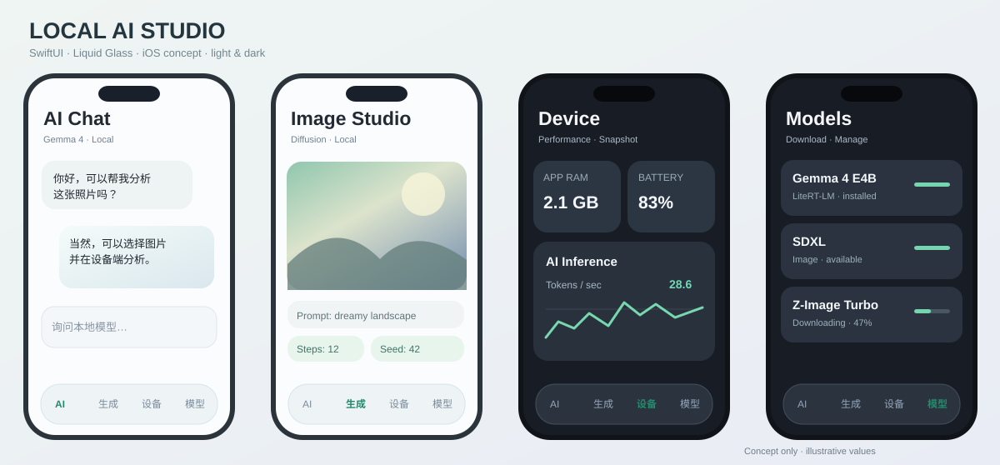
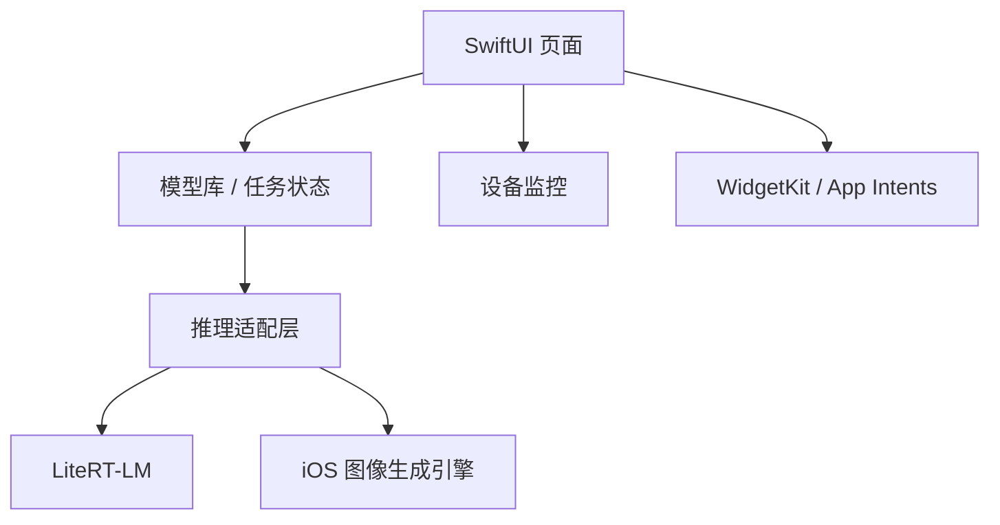

# Local AI Studio — 开发计划

> 状态（2026-11-03）：开发分支 0.5.0 已接入模型架构识别、生图主模型转换、LoRA 转换／应用和 Q8P 主权重量化。编译状态以对应提交的 Actions 为准；这些新路径尚未完成目标 iPhone 的真实权重验收。

## 当前实施进度

| 范围 | 当前状态 |
| --- | --- |
| 原生界面、设备监控、模型库 | 已实现；前台跨页面采样，后台暂停 |
| LiteRT-LM 文本 | 用户已确认 3.66 GB 模型导入并生成回复 |
| GGUF／MLX 文本 | 已接线；GGUF 的 0.3.0 IPA 已产出，新后端仍需真机验收 |
| 架构识别 | GGUF 元数据、MLX 配置、Safetensors 元数据／张量结构；无法确定时保留未知；旧条目可重新识别 |
| 生图模型转换 | 接 ModelOp，保存独立模型包和配套组件；按界面给出的受支持基础配置转换，不承诺任意架构 |
| LoRA | 接本地转换与生图权重设置；生成前核对底模架构；LoKr／聊天 LoRA 尚未接入 |
| 量化 | 已转换生图主模型可另存 Q8P 版本；其他组件保留原精度；聊天模型端内转换／量化未实现 |
| 生图 | 已接文本提示、取消、PNG 导出；实际出图／效果／内存待真机验证 |
| 后台持续推理、Widget、Live Activities、快捷指令 | 尚未实现 |

以下仍为完整产品目标和后续验收标准，不代表全部完成。

## 1. 产品目标

做一个以本地运行和用户自行管理模型为核心的通用 iOS App，不绑定 Gemma、Krea 等某一个模型；使用 Swift + SwiftUI 原生 Liquid Glass，界面简约、易维护。

主要功能：

- 本地 LLM/VLM：首个目标 Gemma 4 E4B；流式聊天、多轮、图片输入。其他引擎按实际兼容性扩展。
- 本地生图：从成熟 iOS 推理库接入一个可运行的模型族，再逐步支持 SDXL、Z-Image、Krea 及兼容 LoRA；LoKr 属于待验证能力。
- 模型库：导入本地文件、URL 下载、管理磁盘文件、识别模型格式与依赖；**能下载不代表能运行**。
- 系统状态：公开 API 可获得的设备、电量、存储、热状态，当前 App 的内存与 AI 性能。
- 系统集成：WidgetKit 性能快照、ActivityKit 生成任务进度、App Intents/Shortcuts。
- 内存优先：大型模型避免同时常驻，不让 UI 状态误导用户认为推理是稳定和可后台永久执行的。

## 2. UI 规划

四个主要页面：

| 页面 | 核心内容 | 主要操作 |
| --- | --- | --- |
| AI | 对话、模型切换、流式消息、图片输入 | 发送 / 停止 / 清空 |
| 生图 | 模型与适配器、Prompt、步数、尺寸、结果 | 生成 / 取消 / 保存 |
| 设备 | RAM 与本 App 内存、运行预算、电池、热状态、AI 耗时 | 查看快照和性能历史 |
| 模型 | 本地模型、URL 导入、下载进度、架构信息、已占空间 | 下载 / 导入 / 删除 |

附加**设置页**：跟随系统 / 浅色 / 深色；遵守系统“降低透明度”和“减少动态效果”。优先使用原生组件和玻璃材质，避免自绘厚重蒙版。

**小组件方案：** 小组件展示上次采集的性能快照与更新时间，点击进入 App；运行中的生成任务使用符合系统要求的 Live Activity。WidgetKit 不承诺秒级更新。锁屏、桌面、控制中心入口按签名权限和系统能力逐步验证。

## 3. 简约架构

真正存在多种引擎时才建立小型共同接口。不要预先制作庞大的插件框架、格式转换系统或多层 Manager。

模型默认存储在 App 自己的 Application Support 目录。导入前检查必要元数据、目标引擎与可用磁盘空间。首版只接受 **HTTPS 文件直链 + 系统文件导入**；Hugging Face/CivitAI 仓库链接解析作为后续扩展，避免误称“任意 URL 下载即可运行”。

## 4. 内存与稳定性

iOS 使用统一内存；模型权重磁盘大小不是运行峰值。iOS 可在未发内存警告时直接终止进程（jetsam），因此不承诺零闪退。

- 开始大型推理之前读取当时的进程可用内存预算；已有真实测量数据时估算峰值；无依据的模型显示“尚未验证”。
- 同一时间只保留一个重量级推理任务；切换模型应等待旧任务取消与资源完成释放。
- 避免额外的高频监控与复杂回退；在模型加载、采样边界、VAE 解码等真实内存风险点检查。
- 支持用户取消和任务输入保存。被系统杀死后可以恢复任务配置；除非推理后端支持检查点，否则**不能承诺续跑到原进度**。
- 内存不足时明确提示降低尺寸、批次或选择量化版；不要静默修改用户参数。
- 性能显示区分 RAM 总量、本 App 使用量、进程可分配预算；不伪造全局 GPU 利用率和独立显存。

## 5. 后台运行的真实边界

首选前台推理。用户显式启动的长任务可以评估 `BGContinuedProcessingTask` 与相应支持的背景 GPU 能力，但它依赖 iOS 版本、运行时条件和 Entitlements，并可能被系统终止。**第三方 P12 本身不保证拥有这些权限。** 不使用音频、定位等无关后台模式“保活”。

## 6. 开发顺序与验收

| 阶段 | 交付与验收 |
| --- | --- |
| 0. 仓库初始化 | AGENTS.md、README、.gitignore、计划和 UI 示意图；不提交权重或证书 |
| 1. 最小原生 App | iOS 真机可打开；浅/深色、四页导航；CI 能生成未签名 IPA |
| 2. 模型下载与监控 | HTTPS 下载、Files 导入、磁盘清理；只显示真实公开 API 指标 |
| 3. Gemma 4 | 首次本地加载、流式文本输出、取消和释放内存，真机验证 |
| 4. 图像生成 | 先接入一个实际可运行的架构，完整生成并保存图片 |
| 5. 社区模型与适配器 | 加载兼容 Checkpoint/LoRA，验证前后效果；LoKr 单独做可行性验证 |
| 6. 系统集成 | 签名权限允许时实现小组件、Shortcuts、Live Activity |
| 7. 稳定性 | 测试内存高压、下载中断、模型切换、后台终止与数据恢复 |

每个阶段在真实设备验证实际能力。不把产品路线图写成实现进度。

## 7. 构建、签名与安全

- Windows 11 + WSL2 / VS Code 负责编辑。
- GitHub Actions 使用 macOS + Xcode 构建**未签名**应用与 IPA。
- 本地使用 P12 + 密码 + 匹配的 `.mobileprovision` 签名，不把证书、密码或私人密钥放到 GitHub。
- Widget Extension 具有独立 Bundle ID，需匹配的签名配置；若现有证书/profile 不支持，先构建主 App。
- 不提交模型权重；下载模型需遵守原作者许可与获取渠道约束。

## 8. 尚未确认的技术问题

1. MediaGenerationKit 在独立 App 中的版本、可用 API、许可证义务及具体模型覆盖。
2. Krea LoKr（包括 SNOFS）能否安全应用于移动端量化权重。
3. 当前签名 Profile 可否签 Widget / Live Activity / 相关后台权限。
4. 不同量化模型在目标 iPhone 上的真实峰值内存和耗时。

这些问题在实现对应功能时通过最小真机实验确认，不提前搭建大量兼容代码。
